# Mermaid Studio · 可视化 Mermaid 编辑器

参照 [mermaid-visual-editor-delta.vercel.app](https://mermaid-visual-editor-delta.vercel.app/) 重写的可视化 Mermaid 流程图编辑器。
拖拽画布 + 双向同步 Mermaid 语法，**重点是两件事**：

1. **能自定义自己的节点块**（形状 / 颜色 / 端口 / 字段 / 标签模板 / Mermaid 模板，全部可视化配置）；
2. **能保存**（自动保存到浏览器本地、多图表管理、工程 JSON / .mmd / SVG / PNG 导入导出）。

另外还有一套「像 Figma 那样干活」的能力：**拖拽框选 + 批量操作**、**图层面板**、**可拖动可缩放的分组**、**颜色可选「无」**。

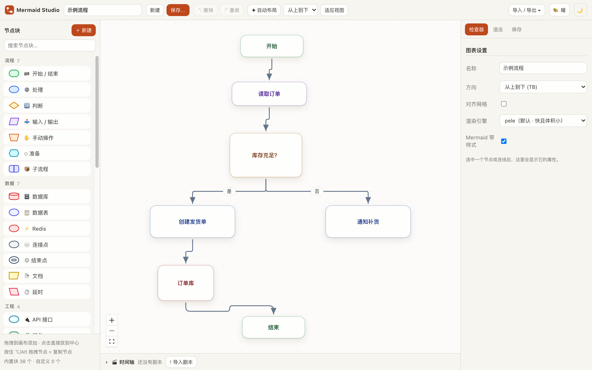

---

## Logo


一个「菱形（判断）→ 折线 → 圆角矩形（处理）」的极简图形，落在陶土橙圆角底上——一眼说明这是画流程图的工具。

| 文件 | 用途 |
| --- | --- |
| `public/logo.svg` | 源文件（矢量，64×64 viewBox），同时用作 favicon 和顶栏品牌标识 |
| `public/apple-touch-icon.png` | 180×180 光栅化图标（iOS / 桌面书签） |
| `docs/logo.svg` | 文档用同一份 |

重新生成 PNG（改了 SVG 之后）：

```bash
# 需要带调试端口的 Chrome
"/Applications/Google Chrome.app/Contents/MacOS/Google Chrome" --headless=new --no-sandbox \
  --remote-debugging-port=9333 about:blank &
node scripts/make-icon.mjs 180
```

## 快速开始

**日常使用（推荐）**：双击 `启动 Mermaid Studio.command`，浏览器会打开 <http://127.0.0.1:5273/>。
服务默认绑 `0.0.0.0`，启动窗口会额外打印一行 `· 局域网访问：http://<本机IP>:5273/`，同网段的手机/平板直接打开即可。
停止用 `停止 Mermaid Studio.command`，改完代码用 `更新并重启.command`。
细节见 **[docs/DEPLOY.md](docs/DEPLOY.md)**（数据在哪、怎么备份、怎么升级、常见问题）。

**开发调试**：

```bash
cd mermaid-studio
npm install          # 首次
npm run dev          # http://127.0.0.1:5274/（5273 留给正式使用，避免端口冲突；同样绑 0.0.0.0）
```

其他命令：

```bash
npm run typecheck                                  # tsc --noEmit
npm run build                                      # 产出 dist/
node scripts/serve.mjs                             # 起正式静态服务（默认 0.0.0.0:5273）
node scripts/check-build.mjs http://127.0.0.1:5273 # 构建产物验收（9 项）
MS_BASE=http://127.0.0.1:5274 bash scripts/run-e2e.sh  # 开发回归（213 项）
```

> 注：项目所在磁盘是 exFAT，`vite.config.ts` 里开了 `server.watch.usePolling`，否则热更新在这些分区上不生效。

## 功能一览

| 区域 | 能力 |
| --- | --- |
| 画布 | 拖拽/缩放、**框选批量选择**、对齐网格、拖拽落点建节点、拖动端点连线、连线重连；**左右两栏可手动收起**（收起后画布铺满，边缘留一条细条可点开） |
| 批量操作 | 框选（≥2 个元素）后浮出操作条：一键**编组/加入分组/移出分组**、六种对齐、水平/垂直等距、复制、删除、只显示选中 |
| 节点块调色板 | 38 个内置块 + 自定义块，分七栏（流程 / 数据 / 工程 / **角色** / **主体** / 其他 / 我的）、搜索、拖拽或点击添加 |
| 节点 | **全部 Onevra 卡片化外观**（surface 底 / 14 圆角 / 1px 细描边 / 柔和投影 / 选中外环 / 悬停抬升 / 连接点悬停才显示）、**拖入画布即自动选中**并切到检查器、**⌥/Alt 拖拽复制节点**、双击改文字、检查器改形状/配色（可选「无」颜色）/尺寸、选中后拖**四个角**缩放、切换节点块、字段值编辑（表格类字段可直接在节点上双击编辑） |
| 图层 | 图层面板列出全部元素（分组带子节点）、搜索、单击选中、⌘/Ctrl 点击或双击定位、👁 隐藏、🔒 锁定、↑↓ 调层级、删除；**入口暂时收起**（右侧只剩 检查器 / 语法 / 保存 三个标签，需要时把它加回 [App.tsx](src/App.tsx) 的 `RIGHT_TABS` 即可） |
| 连线 | **标签规范化为「类型」或「类型: 说明」（10 种固定类型）**、单击选中、双击就地改标签、5 种曲线、实线/虚线/加粗、起止标记、颜色、粗细、流动动画；**端口按方向自动分配（上进下出 / 左进右出）**，拖过端点就固定在人工指定的端口，节点移动/缩放时端点始终吸附在端口上；**选中一条连线时，两端节点会浮到最上层并常显连接头**（线实际用到的那个口高亮），方便看清它从哪出来；**连线走向可手动调**：选中后每段旁边都有「＋」，可加任意多个拐点（可拖、双击删），拐点浮在标签上面，**拖动节点后仍自动补成直角** |
| 分组 | `subgraph` 容器块，**可拖动（带动组内节点）、可缩放、可适应内容**，序列化为 `subgraph ... end`；**支持嵌套**，导入后盒子自动包住全部成员，并且**垫在成员下面**（不会挡住节点） |
| 排版 | dagre 自动布局：分组内外**同一个方向**（分组先当超级节点排一次，再递归排组内），4 个方向；导入后节点顺序按**从上到下**整理 |
| 关系图谱 | 顶栏一键切到**只读**的关系图谱：同一份图换成力导向摆法，点一张表 1~2 跳高亮、其余**压暗而不隐藏**；虚线仍是待确认项、标签不合规的连线标 ⚠；双击点回流程图并定位。**坐标不写回文档**，切走再切回流程图排版分毫不动 |
| Mermaid | 实时生成、可手动编辑、复制、下载 `.mmd`、**导入 `.md`（自动抽 ```mermaid 代码块）** / `.mmd` / 解析手写 Mermaid；**导入时按文字实际宽度撑开节点**（长中文标题不会被省略号吃掉）；节点挂 **7 个固定语义 classDef**（role / action / process / table / job / mq / external） |
| 时间轴 | **剧本回放**：导入原始事件 JSON（delta / 整表快照两种格式）→ 自动匹配数据表节点 → 在「审阅」里裁掉非核心表（可恢复）→ 播放/暂停/倍速/拖动播放头：表节点从「字段: 类型」切换成「字段: 值」，事件触发连线闪烁、字段值渐变；可导出只含核心表的剧本 JSON |
| 渲染引擎 | 默认 **pele**（Obsidian 团队做的零依赖渲染器：同步、快、SVG 小 16 倍、主题走 CSS 变量不重渲）；pele 失败自动回退官方 **mermaid.js 12**；检查器「渲染引擎」可手动切换 |
| 预览 | 内嵌 mermaid 实时渲染，出错显示原因 |
| 部署 | 构建产物 + **零依赖本地静态服务**（固定 `http://127.0.0.1:5273`，默认绑 `0.0.0.0` 局域网可访问）、双击启动/停止/更新脚本、**全量备份与恢复** |
| 保存 | 浏览器本地自动保存 + 多图表管理；**「保存…」弹框可选本地目录**（默认导出带 frontmatter 的 `.md`，Obsidian / AI 直接可读）；**自动保存常开**（没有开关，也不在顶栏显示状态），而且**保存文件按图表归属**：新建/换图各写各的，不会串到上一张图的文件 |
| 导出 | `.mmd` / `.svg` / `.png`（2 倍图）/ 工程 `.json` / 节点块 `.json` |
| 节点 ID | 自动生成**语义化 ID**（`前缀_英文蛇形_随机`，中文标签自动翻成英文），检查器里可**人工改名**，导出/导入保持稳定 |
| 皮肤 | **暖色（默认，陶土橙）** / 冷色 一键切换，深浅色各一套；皮肤只换外壳与预览主题，节点语义色不变 |
| 右侧面板 | 标签条贴在面板顶部，只剩 **检查器 / 语法 / 保存** 三个标签（间距 2px）；图层、节点块、预览三个标签已收起（代码都还在，见 `RIGHT_TABS`），面板内容独立滚动 |
| 其他 | 撤销重做、深浅色主题、Toast 提示、`window.__ms.store` 调试入口（dev） |

快捷键与操作：

| 操作 | 说明 |
| --- | --- |
| 左键拖拽空白处 | **框选**一批元素（画布左上角可切成「平移」模式） |
| 中键 / 右键拖拽，或按住空格拖拽 | 平移画布（默认光标是箭头，按住空格才变手型） |
| Shift / ⌘ / Ctrl + 点击 | 加选、减选 |
| **⌥ / Alt + 拖拽节点** | **拖出一个副本**：原件留在原地（连线也不动），副本落在鼠标位置并自动选中；多选时整组一起复制 |
| `Ctrl/Cmd+S` | 保存 | 
| `Ctrl/Cmd+Z` / `Ctrl/Cmd+Shift+Z` | 撤销 / 重做 |
| `Delete` / `Backspace` | 删除选中 |
| `Esc` | 取消选择 |

框选（或加选到 2 个以上元素）后画布底部会出现批量操作条：编组、加入分组、移出分组、左/中/右/顶/中/底对齐、水平/垂直等距、复制、只显示这些、删除。
只选中一个元素时不显示这条浮动条（单元素操作都在右侧检查器里），免得它挡住画布下方的连接口；正在拉连线时它也会自动让开鼠标。

### ⌥ / Alt 拖拽复制

按住 **Option（macOS）/ Alt（Windows）** 拖动任意节点，就会拖出一个副本：

- 原件**留在原地**，并且**保留它原来的连线**（拖动过程中连线不会跟着甩）；
- 副本落在你松开鼠标的位置，并自动变成当前选中项，可以直接改名/改字段；
- 多选了几个节点时，整组一起复制；
- 拖动分组时，组内节点不会被带走；
- 只按住 ⌥ 点一下（没有真的拖动）不会产生副本；
- `Ctrl/Cmd+Z` 一次撤销就能把副本去掉。

> 副本不复制连线（和工具栏/检查器里的「复制」行为一致），需要连线时手动拉一下即可。

### 连线标签规范

每条连线都要有标签，格式只有两种：`类型` 或 `类型: 说明`，**类型只能从这十种里选**：

| 类型 | 含义 | 典型 起点 → 终点 |
| --- | --- | --- |
| 操作 | 角色触发 | `r_` → `a_` / `p_` |
| 下一步 | 流程先后，不涉及调用方式 | 任意 |
| 同步 | 同步调用（HTTP/RPC/本地方法） | `p_` → `p_` |
| MQ | 异步消息 | `p_` → `m_` → `p_` |
| 定时 | 由定时任务触发 | `j_` → `p_` |
| 写 | 写表 | `p_`/`a_` → `t_` |
| 读 | 读表 | `p_` → `t_` |
| 配置 | 配置数据影响行为 | `r_`/`p_` → `p_` |
| 关联 | 表之间的外键或业务键 | `t_` → `t_`（说明里写字段，如 `关联: order_id`） |
| 调用外部 | 调用外部系统 | `p_` → `x_` |

- **新建连线默认空白**：不带类型也不带说明（不会被上一次连线的内容带跑）。选中它以后，检查器会按两端节点的 ID 前缀给出推荐（`r_→p_` 给「操作」、`p_→p_` 给「同步」、`j_→p_` 给「定时」、`p_→t_` 给「写」、`p_→x_` 给「调用外部」…），点「按推荐补全」即可；`p_ → t_` 读/写都有可能，默认推荐「写」。
- **检查器**：连线选中后有「类型」下拉（只列这十种 + 未设置）、「说明」输入框，下面是实时标签预览；不合规时会红字提示并给出「按推荐补全：X」按钮。

  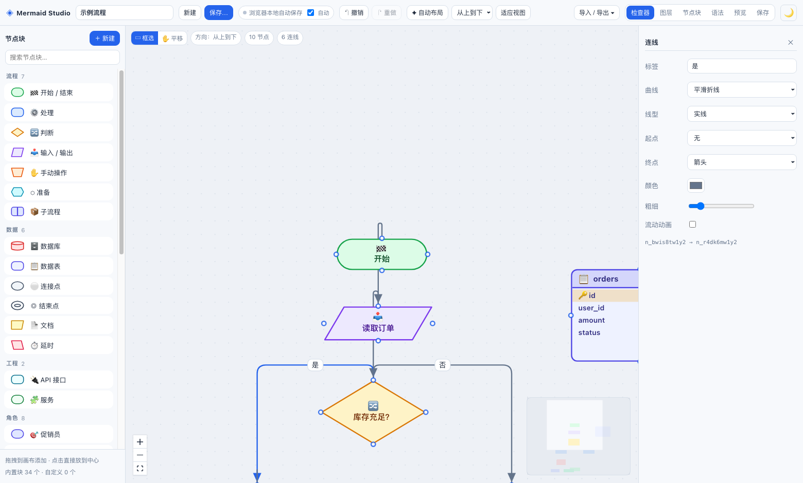

- **双击连线就地改标签**也遵守规范：输入 `写: order_data` 会拆成类型 + 说明；已有类型时输入的文字直接当说明；没有类型时按原样保留（并标为不合规）。
- **不合规会被标出来**：图层面板里不合规的连线行前面是 ⚠，检查器里可以下拉改成十种规范类型之一；老数据里的自由文本标签会原样保留成「类型: 说明」导出。
- 导入别人写的 `.mmd` 时，`外部调用 / sync / read` 这类别名会自动归一化成规范类型。

- 单击连线即可选中，右侧检查器里改标签、曲线、线型、起止标记、颜色、粗细、动画；
- **双击连线（或它中间的标签）就地编辑标签**，回车提交、Esc 取消；没有标签的连线中间会浮出一个淡淡的 ＋ 提示；
- 连线端点始终吸附在你拖拽时选的那两个端口上，节点移动或用四角缩放手柄改变大小时都会跟着走；
- **选中连线后**两端节点的四个连接头会常显（选中的那条线用到的口用实心圆 + 光晕标出来），同时这两个节点会被抬到其它节点之上——连线原本常从节点底下穿过，这样才看得出它到底接在哪。
- **连线走向可手动调**：选中连线后，**每一段（端点之间、拐点之间）旁边都会浮出一个虚线「＋」**，按住任意一个拖出来就在那一段加一个拐点（一条线可以有任意多个）；拐点可以继续拖、**双击删掉**，检查器里能看到「拐点 N 个（双击拐点可删）」和一键「清除拐点」。拐点画在标签层之上，**和标签同坐标时也压在上面**，不会被标签挡住拖不动。有拐点时会按**直角折线（自动补横竖拐角）+ 圆角**画，不会出现斜线；拖动节点后连线会重新补拐角、依旧保持直角（只有把「曲线」显式设成「直线」时才允许斜线）。拐点只存在画布数据里（工程 JSON 会保存），Mermaid 语法不描述走向，导出 `.mmd` 时自然忽略。

### 连接口：上进下出 / 左进右出

节点四个口（上 / 右 / 下 / 左）默认**顺着骨架方向**用，而不是「上方出、下方进」：

| 方向 | 出口 | 入口 |
| --- | --- | --- |
| `TB`（从上到下，瀑布式，默认） | 下 | 上 |
| `BT`（从下到上） | 上 | 下 |
| `LR`（从左到右） | 右 | 左 |
| `RL`（从右到左） | 左 | 右 |

这样在从上往下的图里，连线是「从 A 底下出来、进到 B 顶上」，不会绕一大圈。具体规则：

- **导入 Mermaid / 新建连线**时按当前方向自动分配端口，边记为「自动」。
- **切方向**（顶栏的 4 个方向按钮）时，「自动」的边跟着翻面：`TB` 改 `LR` 就从下出上入变成右出左入。
- **人工可调**：直接把连线端点拖到别的口，或在检查器里用「出口 / 入口」下拉指定，这条边就变成「人工」，之后切方向不再覆盖它；下拉里选「自动」或点「⟲ 恢复自动」交回给方向决定（检查器里还有「⟲ 全部按方向重设」，一次性收拾所有自动边）。
- **老文档**：打开时如果连线没有端口记录，会按文档方向补上，历史图不用重新画一遍。
- 自定义块的端口 id / 数量随便定（比如「注释」块只有左右两个口），自动分配按**端口方位**找，找不到对应方位时退让到最近的可用口。
- 分组**内外方向一致**：`TB` 的图里组内也从上往下（父分组、子分组层层往下套），组内连线同样「下出上入」；没有连线的兄弟节点会并排放在同一层，省空间。

  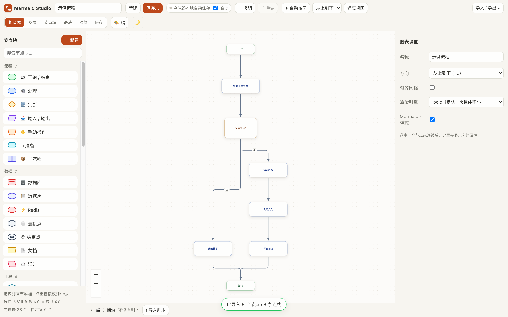

---

### 全视图：收起左右栏

- 左栏「节点块」标题右侧、右栏标签条右端各有一个 **‹ / ›** 收起按钮；
- 收起后画布会自动变宽（左栏 244px、右栏 320px 一并让出来），那一侧的**边缘中间留一条细条**，点一下就展开；
- 两栏都收起时画布铺满整个窗口（实测 1560 宽窗口下画布正好 1560，无横向滚动）。

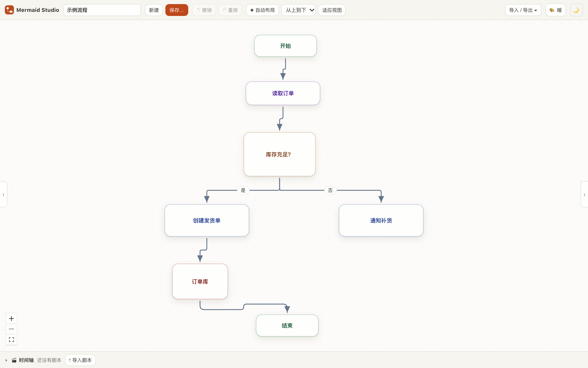

---

## 一、自定义节点块（核心）

一个「节点块（Block）」= 一种可复用的节点样式 + 语义，存在本地并出现在调色板里。
入口：左侧调色板「＋ 新建」，或工具栏「节点块」标签页里对任意内置块点「复制为我的块」。

一个块可配置：

| 配置项 | 说明 |
| --- | --- |
| 名称 / 分组 / 图标 / 说明 | 调色板展示信息（图标支持 emoji） |
| 类型 | 普通节点 或 分组容器（`subgraph`） |
| 渲染方式 | 按形状，或**表格**（表头 + 字段列表，自动按行数算高度、主键高亮） |
| 形状 | 16 种 Mermaid 形状：矩形、圆角、胶囊、子流程、圆柱、圆、双圆、菱形、六边形、平行四边形、反向平行四边形、梯形、反向梯形、旗形、纯文本、分组 |
| 配色 / 默认尺寸 | 节点创建时套用的默认外观（单个节点仍可再覆盖） |
| **端口（ports）** | 上/右/下/左 + 输入/输出/双向；可用「四向 / 左右 / 上下」一键预设。端口决定连线的进出位置 |
| **字段（fields）** | 文本 / 多行文本 / 数字 / 下拉 / 开关，会变成检查器里的输入控件，值存在每个节点上 |
| **标签模板** | 用 `{{label}}` 和 `{{字段key}}` 组合节点显示文本，`\n` 换行。<br>例：`{{label}}\n{{method}} {{path}}` → 节点上显示「下单接口 / POST /api/orders」 |
| **包装符覆盖** | 直接改 Mermaid 的括号，例如 `{{` … `}}`、`[/` … `/]` |
| **行模板** | 完全接管这一行的生成：`{{id}} {{label}} {{open}} {{close}} {{shape}} {{字段key}}` |
| **classDef** | 生成的 `classDef` 样式体，例如 `fill:#ecfeff,stroke:#0e7490` |
| 附加原始行 | 高级用法：用到这个块时，在文档末尾追加任意 Mermaid 行 |


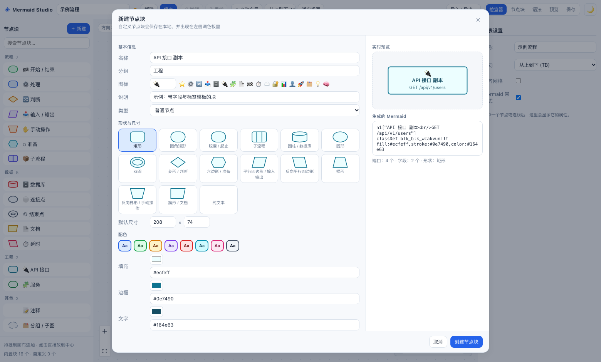

内置示例（也是模板参考）：

- **API 接口**：字段 `method`（下拉）+ `path`，标签模板 `{{label}}\n{{method}} {{path}}`，带 `classDef`；
- **服务**：字段 `tech` / `owner`；
- **分组 / 子图**：`kind = subgraph`，框住的节点会写进 `subgraph ... end`；
- **数据表**：`layout = 'table'` + `columns` 多行文本字段（每行 `字段名: 类型`）+ `pk` 主键字段，渲染成表格式节点；
- **Redis**：`layout = 'json'` + `key` / `json` 两个字段，渲染成「表头 + JSON 结构」的节点；
- **定时任务 / MQ**：工程栏里的两个块，分别带 cron 表达式和 Topic / 消费组字段；
- **角色 / 主体**：`builtin.role.*`（9 个角色）与 `builtin.subject.*`（9 个业务主体），胶囊形与双线框区分，配色按类别成组。

### 角色 / 主体（两栏）

| 栏目 | 节点 |
| --- | --- |
| 角色 | 促销员、拣货员、配送员、财务专员、客服、收银员、店长、品类主管、**顾客** |
| 主体 | 供应商、联营商、渠道平台、配送商、商户、支付服务商、自营商、集团、分公司 |

两栏都由 `src/blocks/builtins.ts` 里的 `ROLE_ITEMS` / `SUBJECT_ITEMS` 数组生成，想加新角色/主体，往数组里加一行 `['名称', '图标']` 即可。它们就是普通的节点块，可以照常改颜色、加字段、复制成自己的块。

### 数据表 / Redis 节点（数据栏）

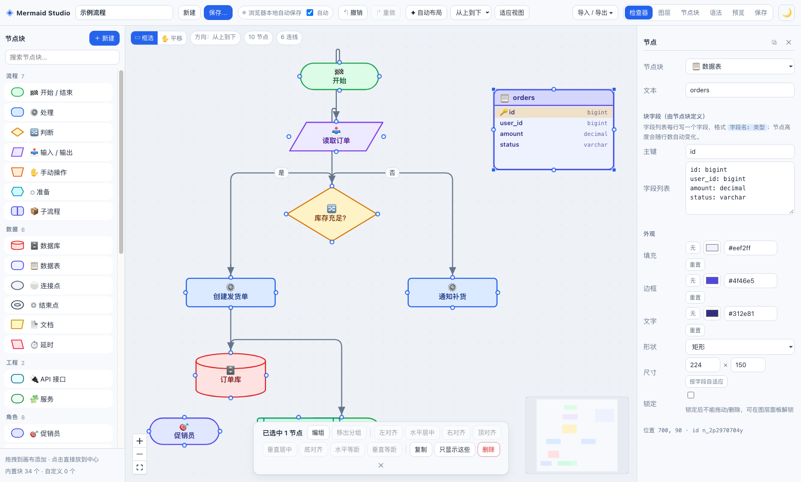

「数据表」块把表结构直接画成表格：表头是表名，下面是字段列表（`字段名: 类型`，每行一个），主键行会自动高亮 🔑。

字段名和类型都支持轻量富文本：`<font color='red'>order_id</font>: 订单id (1:1)` 会在画布上渲染成红色的 `order_id`，`<b>` / `<i>` / `<u>` / `<s>` 同样生效；这些标记会原样写进 Mermaid 标签（导出后 Mermaid 也能识别）。**注意用单引号**（`color='red'`），双引号会被 Mermaid 转义成 `&quot;`。
高度会随字段行数自动调整，四个方向都有连接口，字段列表有两种编辑方式：

- 右侧检查器里的**多行输入框**（每行一个字段）；
- 直接**双击节点上的字段区域**就地编辑（⌘/Ctrl+Enter 提交，Esc 取消）。

Mermaid 侧会输出成带 `<br/>` 换行的节点标签，往返导入导出不丢字段。

**Redis** 块用 JSON 表示结构：表头是节点名 + `Key` 徽标，下面是 JSON 文本，高度按行数自动算。

```json
{
  "type": "hash",
  "ttl": "7d",
  "fields": { "name": "张三", "level": "VIP" }
}
```

- 检查器里有多行编辑框 + **「格式化 JSON」**按钮（两空格缩进），并实时提示 `JSON 合法 / 不合法`（不合法时给出行列位置）；
- 双击节点上的 JSON 区域也能就地编辑（⌘/Ctrl+Enter 提交）；
- 改完自动按行数调高度，也可以点「按内容自适应」。

### 定时任务 / MQ（工程栏）

| 块 | 形状 / 颜色 | 字段 | 语义类 |
| --- | --- | --- | --- |
| ⏰ 定时任务 | 六边形 · 黄 | `cron` 调度表达式、`job` 任务说明 | `job` |
| 📨 MQ | 双线框 · 绿 | `topic`、`group` 消费组 | `mq` |

两个块都支持 `⌥/Alt` 拖拽复制、分组、图层等所有既有能力。

删除自定义块时，用到它的节点会自动回退到默认块，不会破坏图表。

## 二、框选、批量操作与图层

### 框选

画布左键拖拽 = 拉出选框批量选择；平移用中键/右键拖拽，或按住空格拖拽（默认是普通箭头光标）。
框选或加选之后，画布底部会浮出批量操作条：

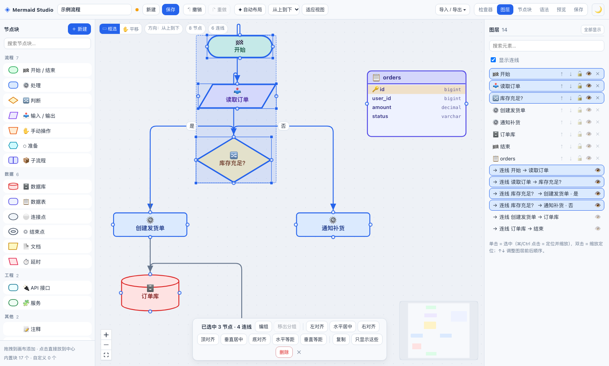

编组 / 加入分组 / 移出分组 / 六种对齐 / 水平垂直等距 / 复制 / 只显示这些 / 删除。

### 图层（Figma 式）

右侧「图层」标签页把画布上的所有元素列成树：分组在前、组内节点缩进，之后是散落节点和连线。

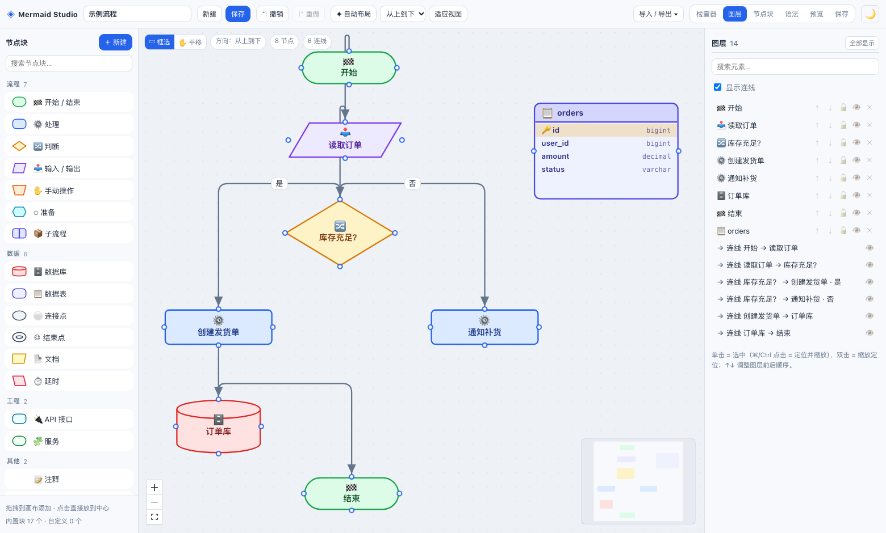

- 单击 = 选中；⌘/Ctrl 单击或双击 = 缩放定位到该元素（找自己画的东西最快的办法）
- 👁 隐藏 / 🚫 显示，🔒 锁定（锁定后不能拖动删除）
- ↑↓ 调整图层前后顺序（分组调层级时组内节点一起平移，不会盖住自己的子节点）
- 顶部支持搜索（按名称/块 id）与「全部显示」

### 分组

分组框现在完全可编辑：

- 拖动分组标题栏（或框内空白处）→ 分组和**组内所有节点一起移动**（按总位移整体偏移，不会累积误差），且不会跳动；
- 选中分组后拖**四角**的小方块 → 缩放分组框；
- 检查器里还有「适应内容大小」「把选中节点加进来」；
- 把节点拖进/拖出分组框，会自动更新归属（`data.groupId`）；
- **分组支持嵌套**：父分组把子分组当成一个整体来排，盒子始终包住里面的所有东西；
- **分组垫在成员下面**：不管是从 Mermaid 导入还是手动编组，分组都不会盖住节点（点节点能直接选中节点）。

从 Mermaid 导入时（`subgraph ... end`）还有两条约定：

- 分组盒子的尺寸由布局算出来并写进节点样式，和里面的节点**严格对齐**（以前盒子固定 460×300，成员会漏到框外）；
- 节点数组按「分组在前、其余从上到下」重排，图层面板的顺序和画布阅读顺序一致。

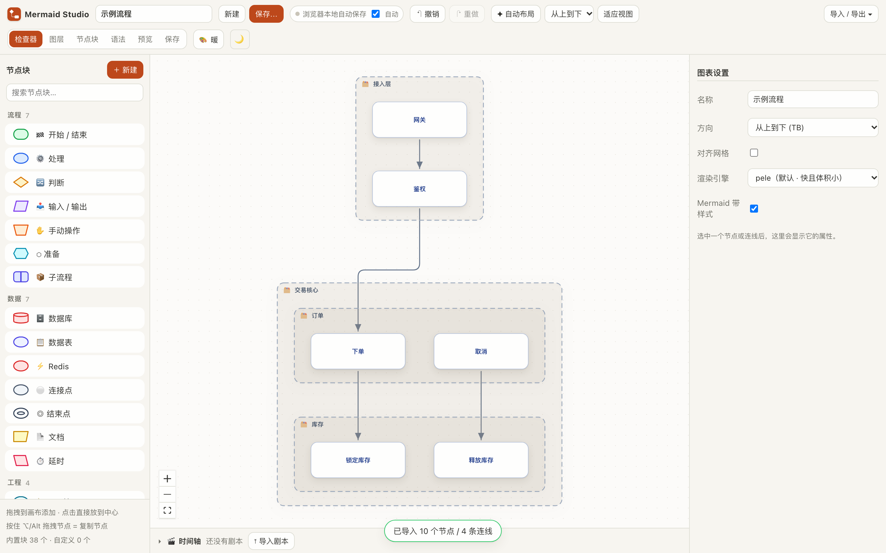

## 三、保存（弹框选位置 + 自动保存 + md 文档约定）

顶栏「保存…」（或 `Ctrl/Cmd+S`）会打开保存弹框：

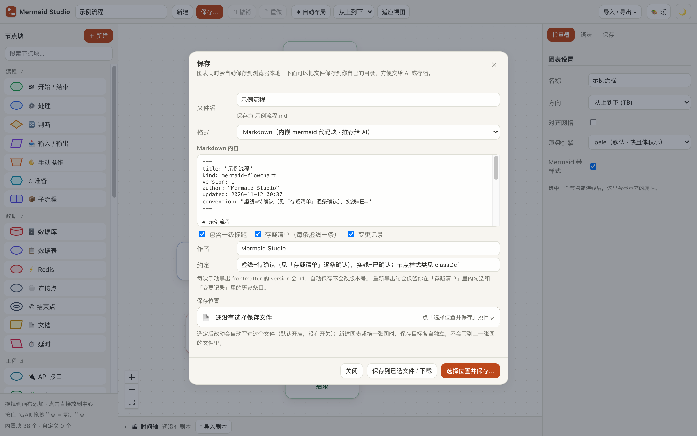

- **格式**默认 **Markdown（.md）**，结构固定，Obsidian 直接打开就是一篇带 frontmatter 的笔记；
- **保存位置**：Chrome / Edge 弹出系统「另存为」窗口，可以自己选目录和文件名；选过之后文件会被记住（IndexedDB），**每张图表记各自的文件**——新建图表不会继承上一张的文件，切回旧图表会自动恢复它自己的目标；
- **自动保存**：默认常开（没有开关、顶栏也不再显示状态），默认每 60 秒把改动写进当前图表选定的文件；没选文件时只写浏览器本地，不会去碰别的图表的文件；
- 无论有没有选文件，**浏览器本地快照（localStorage）始终自动保存**。

### 导出的 .md 长什么样

````md
---
title: "订单流程"
kind: mermaid-flowchart
version: 3
author: "Mermaid Studio"
updated: 2026-10-14 19:04
convention: "虚线=待确认（见「存疑清单」逐条确认），实线=已确认；节点样式类见 classDef"
---

# 订单流程

## 流程图

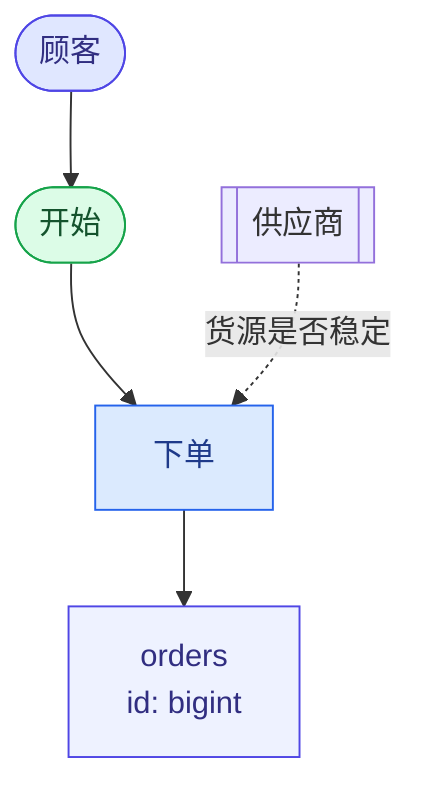

## 存疑清单

<!-- 虚线代表待确认；每条虚线对应下面一条，确认后把 [ ] 改成 [x] -->
- [ ] 货源是否稳定（供应商 → 下单） <!-- ms:e_ab12cd -->

## 变更记录

- 2026-10-14 19:04 v3 导出（7 节点 / 0 分组 / 6 连线）
````

要点：

- **frontmatter 六个字段**：`title / kind / version / author / updated / convention`。作者和约定可以在保存弹框里改，会记住；`version` 每次**手动导出 +1**，自动保存不动版本号。
- **存疑清单**：**每条虚线自动对应一条**，格式 `- [ ] 说明（起点 → 终点）`。行尾那个 `<!-- ms:边id -->` 是给工具认的标记（阅读视图不显示），别删最好；删了也能用，只是重新导出时可能多出一条。
- **重新导出不会覆盖你手写的内容**：勾选状态（`[x]`）、你改过的条目文字、你自己加的条目都会保留；`## 变更记录` 会累积历史条目（保留最近 30 条）；你在文章里另加的章节（比如 `## 备注`）会原样保留在文件末尾。
- 之前版本里那三张「元素清单」表格已经去掉，文档更干净。
- **反过来也能打开**：保存面板的「语法」标签里点 **导入 .md / .mmd**，选一份导出的 `.md` 就能把图恢复到画布（会自动找 ```` ```mermaid ```` 围栏，顺便读 frontmatter 的 `title` 当文档名）。
- 完整示例见 [`docs/sample.md`](docs/sample.md)（就是上面这份）。

### 节点 ID（语义化命名）

新建节点时会按「块类型 + 文本」自动生成 ID，例如：

| 节点块 | 文本 | 生成的 ID |
| --- | --- | --- |
| 角色（顾客） | 顾客 | `r_customer_9k2x1` |
| 手动操作 | 结算 | `a_checkout_7pq3m` |
| 处理 | 生成订单 | `p_create_order_k3t9p` |
| 数据表 | `order_data` | `t_order_data_deq4f` |
| 定时任务 | 超时关单 | `j_close_timeout_xn02c` |
| MQ | `PAY_SUCCESS` | `m_pay_success_usn57` |
| 主体（供应商） | 供应商 | `f_supplier_b58gv` |
| Redis | 购物车缓存 | `rd_cart_cache_h1ola` |
| 分组 | 订单分组 | `d_order_group_p3k8s` |

- **前缀表**（可在节点块编辑器里给自定义块改「ID 前缀」）：

  | 前缀 | 类型 | 前缀 | 类型 |
  | --- | --- | --- | --- |
  | `r_` | 角色 | `m_` | MQ topic |
  | `a_` | 人工操作 | `x_` | 外部系统（自定义块预留） |
  | `p_` | 系统处理 | `d_` | 分组 subgraph |
  | `t_` | 数据表（+ 真实表名） | `rd_` | Redis |
  | `j_` | 定时任务 | `f_` | 主体 |
  | `s_` / `e_` | 开始 / 结束 | `c_` | 判断 |
  | `db_` / `api_` / `svc_` | 数据库 / 接口 / 服务 | `doc_` / `w_` | 文档 / 延时 |

- **中文 → 英文**用内置业务词表（`src/lib/translate.ts`，覆盖下单、支付、履约、对账、库存等常用词）做最长优先切词，转成 `snake_case`；标签本身就是英文（如 `PAY_SUCCESS`、`order_data`）时原样转换；翻译不出来的词用块自己的兜底词（如 `p_process_xxx`）。
- 尾部随机后缀（5 位）保证不重复；ID 生成只在**新建时**发生，改文本不会改 ID（避免连线错乱）。
- **检查器 →「文本」下面就是 ID 输入框**：可以人工改成任意合法 ID（回车提交、Esc 取消），旁边还有「↻ 按名称生成」按钮按当前文本重新生成。改名会自动同步所有连线端点、分组归属、导出的 Mermaid；重名会被拒绝，非法字符会被清洗（`3 非法-id!` → `n_3_id`），并且可以 `Ctrl/Cmd+Z` 撤销。
- **导出再导入 ID 不变**：`.md` / `.mmd` 里的节点 ID 就是画布上的 ID，导入时会沿用（AI 侧可以据此稳定引用某个节点）。

### 节点外观（参照 Onevra）

“形状=类型”在 Mermaid 里本来就没有硬约定，所以画布上的**所有节点都统一成 Onevra 卡片外观**（表格 / Redis 保留各自的卡片式布局，分组保留容器样式）：

| 卡片部位 | 做法 |
| --- | --- |
| 卡片主体 | `surface` 底色 + 1px 半透明描边（按类型轻微染色）+ 14 圆角 + 柔和投影，悬停抬升一点 |
| 内容 | 标题（13px / 600 字重，单行）+ 最多两行 topic 小字（**10px / 400**，比标题更小更细，居中）；**不带图标块** |
| 处理节点的两行 topic | 上方一行是**状态**（`done` / `in progress` / `waiting`，检查器下拉选），下方一行是**函数名**（如 `order_create`）；两行都可留空，留空时卡片只显示标题 |
| 进入 Mermaid | 两行 topic 会跟 MQ 的 topic 一样进入节点标签：`p_xxx["生成订单<br/>in progress<br/>order_create"]:::process`；导入 `.md` 时 `<br/>` 自动还原回状态与函数名字段 |
| **选中态** | 不染卡片描边，改为在卡片外侧画一圈 **2px 主色半透明外环**（半径 17、外扩 3px） |
| 连接点 | 四个端口圆点**默认隐藏**，鼠标悬停在节点上才出现（移开又隐藏） |
| 双击编辑 | 双击在**文字末尾**落光标直接续写（不会整段选中覆盖） |
| Mermaid 输出 | **不变**：仍是 `p_xxx["文字"]:::process` 等语义语法，导出的图与代码面板完全一致；语义色仍在 classDef / 预览里体现 |

| 其它元素 | 做法 |
| --- | --- |
| 连线标签 | 药丸形（999px）+ 1px 半透明描边 |
| 投影配色 | 暖色皮肤用暖调投影，深色主题用更重的暗投影 |
| 形状去哪了 | 画布不再画菱形 / 圆柱等 SVG 形状；形状语义只保留在 Mermaid 导出与预览里（如 `[\.../]`、`[(...)]`、`{...}`） |

### 画布光标：默认箭头，按住空格才是手型

| 状态 | 光标 | 行为 |
| --- | --- | --- |
| 默认 | 普通箭头 | 左键拖拽空白处 = 框选（背景不跟着平移） |
| 按住空格 | 手型（grab / 拖拽时 grabbing） | 左键拖拽 = 平移画布；松开空格立刻恢复箭头 |
| 正在拖拽画布 | grabbing | 中键 / 右键拖拽也一样 |

在输入框（检查器、标签输入框、搜索框）里按空格只会输入空格，不会切手型。

### 皮肤：暖色（默认）/ 冷色

顶栏的 **🎨 暖 / 🎨 冷** 按钮一键切换（选择会记住）。两套皮肤都是完整调色板 × 深浅色四种组合：

| | 暖色（默认） | 冷色 |
| --- | --- | --- |
| 底色 | `#fcfbf9` 暖白 / `#211f1c` 暖炭 | `#eef1f6` / `#0b1120` |
| 主色 | **`#bd481b` 陶土橙**（暗色 `#ed986e`） | `#2563eb` / `#60a5fa` |
| 描边 | `#deded5` 暖灰 | `#d8e0ea` |
| 面板 | `#f7f5f0` | `#f7f9fc` |

- 皮肤**只换外壳**（面板/画布/网格/按钮/选中环）和**预览/导出的主题**；节点与 7 个 `classDef` 语义色**保持不变**——那是图的内容规范，不是界面皮肤；
- 预览和导出的 SVG 会把当前皮肤的主题变量内联到 `<svg>` 内部，所以单独存成文件也能正确显示；
- 皮肤存在 `settings.skin`，刷新后保持。

### 渲染引擎：pele（默认）/ mermaid.js

预览和 SVG/PNG 导出都走同一层渲染（`src/lib/render.ts`）：

| | **pele（默认）** | mermaid.js 12（兜底） |
| --- | --- | --- |
| 性质 | Obsidian 团队重写的渲染器，**零运行时依赖** | 官方完整实现 |
| 渲染 | **同步** | 异步 |
| 体积 | 650 KB 单文件（含 30 种图） | 一张 flowchart 按需拉 ~2.1 MB 分包 |
| 单张图耗时 | 首渲 ~250ms（含加载），**再渲 2~45ms** | 再渲 ~120ms |
| 输出 SVG | **~4 KB** | ~109 KB |
| 主题 | **CSS 变量**，切深浅色不重渲 | 需重新 render |
| 兜底 | pele 抛错时自动回退 mermaid.js | — |

- 检查器「图表设置 → 渲染引擎」可手动切换，默认 `pele`；
- 预览面板底部会显示 `渲染引擎：pele · 45 ms`；
- 导出的 SVG 会把主题变量内联进去（`<style>.pele{…}</style>`），单独发给别人打开也能正确显示；
- 深色主题靠 `--pele-*` CSS 变量切换，**不触发重渲染**。

### 固定的语义 classDef

节点块可以挂一个固定的语义样式类，导出时写成约定的 classDef，方便 AI / 主题按规则识别：

| 类名 | 颜色 | 用在哪 |
| --- | --- | --- |
| `role` | `fill:#e0e7ff,stroke:#4f46e5,color:#312e81` | 角色栏 9 个（促销员…顾客） |
| `action` | `fill:#ffedd5,stroke:#ea580c,color:#7c2d12` | 手动操作 |
| `process` | `fill:#dbeafe,stroke:#2563eb,color:#1e3a8a` | 处理 |
| `table` | `fill:#eef2ff,stroke:#4f46e5,color:#312e81` | 数据表 |
| `job` | `fill:#fef9c3,stroke:#ca8a04,color:#713f12` | 文档 |
| `mq` | `fill:#dcfce7,stroke:#16a34a,color:#14532d` | 开始 / 结束 |
| `external` | `fill:#f3f4f6,stroke:#6b7280,color:#1f2937` | 主体栏 9 个（供应商…分公司） |

- 定义的唯一来源是 `src/lib/classes.ts`，想改颜色改这里一处，画布和导出同步生效；
- 在**节点块编辑器 →「样式类」**下拉里可以给任意自定义块挂上这些类（挂上后画布配色会自动同步成该类颜色）；
- 没挂类的块仍按原来的方式生成 `classDef blk_xxx`；给单个节点改过颜色的，仍然输出 `style 节点 颜色`；
- 导入时（`:...:role`）会优先落到对应语义类的节点块上。

## 四、数据与文件

- **自动保存**：任何改动 0.7 秒后写入 `localStorage`（`mermaid-studio:*`），顶栏脏标记会消失；也可 `Ctrl/Cmd+S` 手动保存。
- **多图表**：右侧「保存」标签页里列出所有图表（节点数/连线数/时间），可新建、复制、重命名、删除、切换。
- **工程文件 `.mermaid.json`**：`{ kind, version, doc, customBlocks }` —— **连自定义节点块一起带走**，换电脑或发给同事都能完整还原。
- **节点块 `.json`**：只导出/导入自定义块，方便团队共享一套块库。
- SVG / PNG 导出复用同一份 Mermaid 语法，所见即所得。

## 五、目录结构

```
src/
  types.ts                 数据模型：形状表、BlockDef、NodeData/EdgeData、DiagramDoc
  store.ts                 唯一状态源（zustand）：图操作、历史、文档、导入导出、自定义块
  blocks/
    builtins.ts            16 个内置节点块（同时是自定义块的写法示例）
    registry.ts            块查找、标签合成、形状↔内置块映射、文件下载等工具
  lib/
    mermaid.ts             画布 → Mermaid 序列化；Mermaid → 中间结构的解析器
    exporters.ts           .md / .mmd / .json / .svg / .png 的生成
    files.ts               本地文件保存（File System Access + IndexedDB 记住句柄）
    layout.ts              dagre 自动布局（含 subgraph 的超级图 + 组内两级布局）
    shapes.tsx             16 种形状的 SVG 绘制 + 调色板缩略图
    factory.ts             节点/连线工厂
    storage.ts             localStorage 读写、示例图
    rf.ts                  React Flow 实例引用（供工具栏调用）
  components/              Toolbar / Palette / Canvas / BlockNode / FlowEdgeView / Inspector /
                           LayersPanel / SelectionActions / ColorField / SaveDialog /
                           CodePanel / Preview / FilesPanel / BlocksPanel / BlockEditorDialog
```

渲染链路：`doc`（唯一数据源）→ 画布（React Flow 受控）→ `toMermaid()` → 语法面板/预览/导出。
反向：语法面板或 `.mmd` → `parseMermaid()` → 自动布局 → 覆盖当前 `doc`。两个方向都只经过 `store`。

## 六、想改什么，从哪下手

| 想做的事 | 改哪里 |
| --- | --- |
| 新增一种形状 | `types.ts` 的 `SHAPE_WRAP` / `SHAPE_LABELS` + `lib/shapes.tsx` 的 `ShapeFrame` |
| 新增内置节点块 | `blocks/builtins.ts` 追加一个 `BlockDef` |
| 改 Mermaid 生成规则 | `lib/mermaid.ts` 的 `toMermaid` / `nodeToMermaidLine` / `edgeToken` |
| 支持更多 Mermaid 语法（如 `classDiagram`） | 扩展 `lib/mermaid.ts` 的 `parseMermaid` |
| 换布局算法（elk / 力导向） | `lib/layout.ts`（已经是独立函数，接口是 `(nodes, edges, opts) => nodes`） |
| 换/加渲染引擎 | `lib/render.ts`（`renderDiagram()` 一个入口，内部 pele + mermaid 兜底） |
| 加新导出格式 | `lib/exporters.ts` 的 `FORMAT_META` + `buildExport`，保存弹框会自动多一个选项 |
| 改 .md 结构（给 AI 的格式） | `lib/exporters.ts` 的 `buildMarkdown` |
| 加新的角色 / 主体 | `blocks/builtins.ts` 的 `ROLE_ITEMS` / `SUBJECT_ITEMS` |
| 改连线交互（标签、命中区域） | `components/FlowEdgeView.tsx` |
| 改缩放手柄 | `components/BlockNode.tsx` 的 `resizeControls` |
| 给节点块加新的渲染方式 | `types.ts` 的 `BlockDef.layout` + `BlockNode.tsx` 里加一个分支 + `structuralNodeHeight` 算高度 |
| 加/改中文→英文词表 | `lib/translate.ts` 的 `TERMS`（加一行 `中文: 'english'`） |
| 改 ID 前缀规则 | `blocks/registry.ts` 的 `PREFIX_BY_BLOCK_ID` / `PREFIX_BY_CLASS`，或节点块编辑器里的「ID 前缀」 |
| 改连线类型表 / 推荐规则 | `lib/edgeLabels.ts` 的 `CANONICAL_EDGE_TYPES` / `EDGE_TYPE_INFO` / `suggestEdgeType` |
| 换存储后端（文件 / 服务端 / Git） | `lib/storage.ts`（只暴露 load/save 若干函数） |
| 图层/框选/批量操作 | `components/LayersPanel.tsx`、`components/SelectionActions.tsx`、`store.ts` 里的 `groupSelection/alignSelection/changeZOrder` 等 |
| 加 AI 生成 / 模板库 | `store.ts` 里加 action，UI 挂在 `Toolbar` 或新面板 |

## 七、剧本（时间轴演示）

画布底部有一条时间轴面板，用来把**一次页面流程里数据表的变化**演示出来。

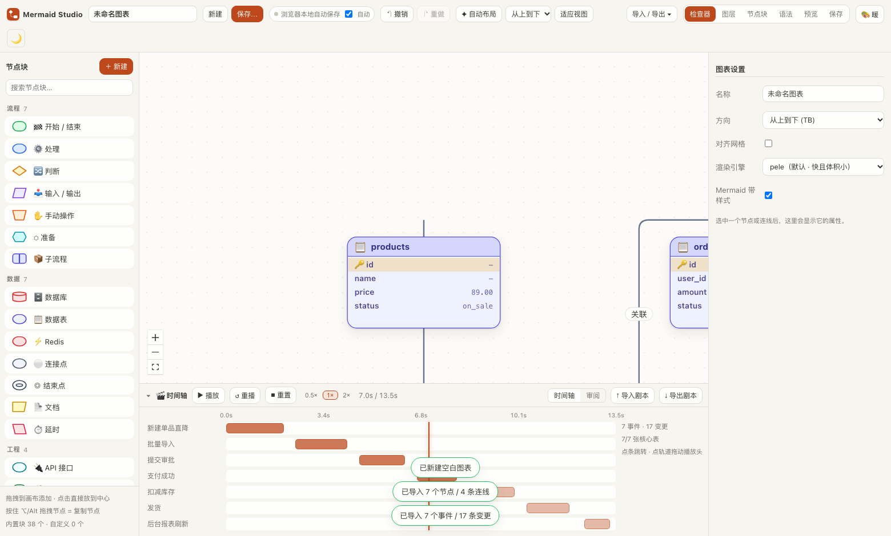

> 沟通用元素编号目录见 [`docs/ui-elements.md`](docs/ui-elements.md)（T01–T13，不显示在页面上）。
>
> 想直接体验：先导入 [`docs/demo-diagram.mmd`](docs/demo-diagram.mmd)（7 张数据表），再在时间轴面板导入 [`docs/demo-scenario.json`](docs/demo-scenario.json)（7 个事件 / 17 条变更），然后点 ▶ 播放。

### 1. 导入剧本

点面板上的「⤒ 导入剧本」，导入一份 JSON（`.json`）。两种原始格式都支持：

```json
{
  "kind": "mermaid-studio-scenario",
  "version": 1,
  "events": [
    {
      "name": "新建单品直降",
      "startMs": 0,
      "durationMs": 2500,
      "changes": [
        { "table": "orders", "field": "id", "value": "1234" },
        { "table": "order_items", "field": "price", "value": "99.00" }
      ]
    }
  ]
}
```

- **delta 格式**（推荐）：每个事件只列变化，`changes: [{ table, field, value }]`
- **快照格式**：`tables: [{ table, values: { field: value } }]`，导入时逐字段 diff 成变更
- `startMs` 不填则接在上一个事件后面；`totalMs` 不填按最后一个事件自动推导

### 2. 表名怎么对上画布上的表

剧本里的 `table` 表名先按**表节点的标题**匹配；对不上的表，如果某个空闲数据表节点的字段集合覆盖了该表用到的字段，会兜底绑定。仍匹配不上的表在「审阅」里用下拉**手动绑定**，不绑就丢弃。

### 3. 裁剪（审阅）

导入后点面板的「审阅」：

- 左侧是剧本涉及的所有表，**勾选 = 核心表**（只有核心表的变更会回放和导出）；取消勾选可随时勾回
- 右侧是事件列表，**✕ 删除整条事件**（可「恢复」或 `⌘/Ctrl+Z` 撤销）
- 面板顶部实时显示「保留 X 张表 / Y 条事件 / Z 条变更」

### 4. 回放

- ▶ 播放 / ⏸ 暂停 / ↺ 重播 / ⏹ 重置，倍速 0.5×、1×、2×
- 表节点在回放期间从「字段: 类型」变成「字段: 值」（如 `id: 1234`），变更的字段有渐变高亮；**值只存在运行时覆盖层**，不写回节点、不影响保存与导出
- 事件触发时，与它相关的连线上会**闪烁**（约 0.9 秒）
- 拖动中间轨道或点甘特条可以跳播放头；拖播放头时表节点实时变化
- 回放期间锁定画布编辑（拖拽 / 连线 / 双击编辑），暂停后恢复；回放不写撤销栈
- 点「重置」回到未回放状态（表节点恢复「字段: 类型」）

### 5. 导出

点「⤓ 导出剧本」导出**核心表剧本 JSON**：只含人工保留的变更（删掉的事件、非核心表、未绑定的表都会被过滤），导出后可以直接再导入回放。剧本随文档保存（localStorage / 全量备份），`.md`、`.mmd`、SVG、PNG 导出**不带**时间轴，Mermaid 代码与预览不受影响。

## 八、关系图谱（只读诊断镜）

顶栏的「流程图 | 关系图谱」是同一个文档的两种看法。图谱不是第二个编辑器：它从 `doc.nodes` / `doc.edges` 派生，**不写回坐标、不调用撤销栈**，切回流程图时你手工排过的位置一个像素都不会变（[ADR-0003](docs/adr/0003-graph-view-derived.md)）。

### 1. 画什么

- 只画实体：**分组框、隐藏元素、没有连线的纯文本**都不进图（图层里关掉的元素在这里也是关掉的）。
- 节点是 Obsidian 式的「一个圆点 + 下面的表名」，连线端点贴在圆点边缘；看字段回右侧检查器，图谱只负责看关系。
- 同一分组的点共用一个底色，用来认出"这几张表属于一个模块"——**不画分组框**（框是流程图的排版概念）。
- 连线沿用既有图语言：**虚线 = 待确认项**，标签不合规的连线标红点 ⚠，箭头照你画的方向走（不推断外键方向）。
- 布局：**焦点钉在圆心**，1 跳一圈、2 跳再一圈（没有焦点时以度数最高的表为根）；环上跑力导向松弛让同一圈的邻居按亲疏抱团。固定随机种子，同一份图每次摆出来一样；只有结构变化或点「重排」才会变。

### 2. 怎么用

- **打开就有焦点**：流程图里选中的表（没有选中就是度数最高的表）直接落在圆心，1 跳邻居浮出来，其余压暗到 30%（**压暗不是隐藏**，随时能点回来）。
- **单击一张表**：它成为焦点并移到圆心。为了不把双击抢掉，重排会延迟 280ms 才发生。
- **拖动节点**：手动把某个点摆到想看的空白处（只存在视图里，不写回文档；点「重排」清掉）。拖动空白处或按住空格拖动都是平移画布。
- **跳数**：左下角「1 / 2 / 全部」（或键盘 `1` / `2` / `0`）。"1 跳看见谁、2 跳又多出谁"是可以数的动作——这正是排查依赖的用法。
- **点空白**：取消焦点，回到整张图装进视口。（`Esc` 同效）
- **双击一张表**：切回流程图并定位到它（选中 + 视口对准）。
- **只看待确认**：左下角勾选后只留虚线边，用来把"还没定的事"从结构里单独拎出来。
- **重排**：换一次随机种子重新排，专门用于打散意外重叠。

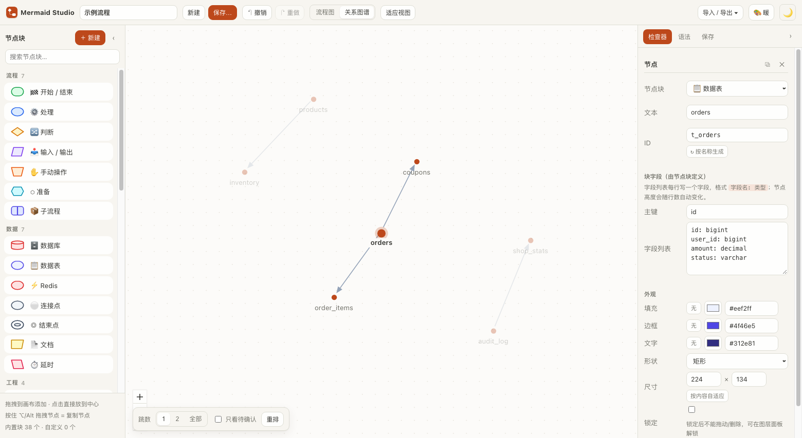

### 3. 边界

- 图谱**不会**替你判断"谁引用谁"：`关联` 这个类型本身不带引用方向与基数，标错方向比不标更伤人。
- 真正的 ER 图（`erDiagram`）目前导不进来（导入器只认 `flowchart`），所以图谱的数据源是"流程图 + `关联` 边"。
- 规模建议 ≤120 个节点；超过 250 个时角落会提示先聚焦到 1~2 跳（不拦着）。
- 视图模式记在全局设置里，**不进 `.mermaid.json`**：它是"看的方式"，不是"图的内容"。

## 九、当前限制（下一轮可以改）

- 解析手写 Mermaid 时支持 flowchart 常用子集：形状、连线（含 `|标签|`、链式 `a-->b-->c`、`A & B --> C` 并列写法）、`subgraph`、`classDef`/`class`/`style`/`linkStyle`、`%%` 注释；`-- 文本 -->` 这种中间标注、`click` 尚未支持（会在导入提示里报告跳过行数）。
- 子图里的 `direction TB/LR` 目前被忽略：分组内统一跟着整张图的方向排（由「分组内外同一个方向」这条规则决定）。
- 节点的字号、边框虚/实线暂未做成节点级配置（形状、配色、尺寸、表格排版可以）。
- 图层不支持拖拽改变顺序（用 ↑↓ 按钮），也没有多选图层行、图层面板里改名的入口（在检查器里改）。
- 缩放只在四个角上（上下左右中间留给连接口，避免抢走连线拖拽）。
- 「自动保存到文件」需要先选一次文件；刷新页面后要在「保存…」里点一次「恢复授权」才能继续写（浏览器的安全限制）。
- Safari / Firefox 不支持 `showSaveFilePicker`，只能用下载方式保存。
- md 的「保留手写内容」要能读到旧文件才行（走系统“另存为”或自动保存目标时可以）；纯下载模式下每次都是新文件，勾选状态不会跨次保留。
- 只有 `role / action / process / table / job / mq / external` 七个语义类；其它节点块仍按颜色生成各自的 classDef。
- 分组嵌套最多按「父框包住子框」处理，缩放分组时不会自动重新排布组内节点（用「适应内容」或重新自动布局）。
- 保存用 `localStorage`（单浏览器，约 5MB）；没有账号、云同步、协作与版本历史（撤销栈只在当前会话内）。
- 导出 PNG 依赖浏览器渲染，超大图可能需要调大 canvas 上限。

## 十、自动化验证

二十一组基于 Chrome DevTools Protocol 的端到端脚本，共 **408 项断言**（建块→用块→序列化→保存→刷新仍在→导入→往返→撤销→布局→预览→深浅色主题→拖拽→重连→多文档→真鼠标框选→一键编组→拖动/缩放分组→图层隐藏锁定调序→颜色「无」→数据表字段编辑与四向端口→指定端口连线→角色/主题两栏→保存弹框与 .md 内容→选位置写入与自动保存→单击选连线→双击改标签→连线跟随节点移动/缩放→拖入自动选中→颜色行无重置按钮→⌥/Alt 拖拽复制→七个固定 classDef 的颜色与类名→md frontmatter→存疑清单逐条对应虚线→手写勾选与历史变更记录在重新导出后保留→自动保存不动版本号→定时任务 / MQ / Redis 三个新块→Redis 的 JSON 渲染与格式化校验→导入后字段还原→十种块的语义 ID 前缀→检查器里人工改名→改名后连线与分组不断→重名保护与非法字符清洗→导出导入 ID 稳定→12 组前缀组合的类型推荐→类型+说明两段式标签→不合规识别与一键补全→类型下拉→别名归一化→全量备份导出→清空本地数据→从备份恢复（图表+自定义块+设置）→刷新仍在→重复导入不覆盖→渲染引擎默认 pele→pele 渲染保真→二次渲染耗时→深色变量不重渲→导出 SVG 自带主题→切回 mermaid 仍可用→皮肤默认暖色→变量/背景/主按钮跟随→预览与导出的主题同步→一键切冷色→持久化→暖色×深色组合→**全部节点卡片化（shape SVG 归零）→卡片投影/圆角/细描边→选中外环用主色半透明且不染描边→药丸标签→深色下投影仍生效→处理节点渲染成卡片（600 字重标题 / Mermaid 输出不变）→处理节点两行 topic（状态 + 函数名，10px/400 居中，进入 <br/> 标签并可反向导入）→所有节点连接点默认隐藏、悬停才出现→双击编辑光标落文字末尾→编辑时鼠标划字不拖动节点→默认箭头光标与空格拖拽手型→输入框里按空格不切手型→**剧本导入（3 事件/4 变更）与表自动匹配→未回放时保持字段:类型→拖动播放头后表节点显示字段:值且不写回文档→播放时播放头前进+连线闪烁+锁定双击编辑→重置恢复字段:类型→取消核心表/删除事件后导出只含保留内容→未绑定表不导出→删除事件可恢复→快照格式导入逐字段 diff→仓库自带 demo 图/剧本可直接导入且全部匹配→**元素编号 T01–T13 目录 / 代码标记 / 各视图可见性一致→甘特条与左侧事件名逐行对齐→**数据表字段里的 <font color> 富文本渲染并原样进入 Mermaid**→连接口默认上进下出 / 左进右出（导入、切方向翻面、人工指定不被覆盖、老文档自动补端口、导出不携带端口信息）→子图导入后包住全部成员（含嵌套、盒子尺寸与数据一致）→分组垫在节点下面、点节点能选中节点→组内也是从上到下的连线→节点顺序从上到下→自动布局后依然成立→导出保留 subgraph 嵌套→**导入时长标题把节点撑宽、不被省略号截断（短标题保持默认宽）**→**真实复杂图（3 分组 + 28 节点 + 平行边）导入不再崩、分组全包含、点节点不被分组挡、`&` 并列展开成多条边、引号标签清洗、往返稳定**→选中连线后两端节点的连接头常显、用到的那个口高亮、端点节点抬到最上层、取消选中后恢复隐藏→右侧标签条在面板内部、只剩三项（检查器/语法/保存）、相邻标签间隙实测 2px→**新建连线默认空白（无类型/无标签、标为不合规）→按推荐补全后类型正确**→**顶栏不再展示自动保存状态、保存弹框没有自动保存开关、保存目标记在当前图表名下、新建后不写进旧文件**→**选中连线出现＋走位手柄、拖出拐点走折线、拖拐点改走向、检查器显示拐点数并一键清除、双击删拐点、拐点不写进 Mermaid**→**左栏/右栏可收起（画布变宽、留展开条）、可再展开、两栏都收起时画布铺满且无横向溢出**→**有拐点时连线保持直角、拖动节点后自动重排仍无斜线段**→**每条段都有＋可继续加拐点（1 个拐点时 2 个＋、可加到 2 个）、拐点与标签同坐标时拐点在最上层且能拖动**→**关系图谱（分组框/隐藏表/无连线注释不进图→圆点 + 表名在下面→打开即有焦点且落在圆心→拖动节点只移动该点且不写回文档→单点聚焦 1 跳亮其余压暗→焦点被摆到圆心→2 跳放大范围→点空白还原→双击回流程图并定位→切走切回坐标逐字节不变→隐藏状态不被改写→视图模式只进 settings 不进文档→刷新后仍在图谱）**）：

```bash
npm run dev                 # 终端 A
bash scripts/run-e2e.sh     # 终端 B：自动拉起 headless Chrome 并跑完二十一组

# 部署后验收（不需要 dev server，针对构建产物）
npm run build && MS_NO_OPEN=1 bash scripts/start.sh
node scripts/check-build.mjs http://127.0.0.1:5273
```

---

## 与参考工具（mermaid-visual-editor-delta）的差异

| | 参考工具 | 本实现 |
| --- | --- | --- |
| 技术栈 | Next.js + React Flow | Vite + React 19 + React Flow 12 + zustand |
| 节点块 | 固定形状，不可自定义 | **可视化自定义节点块**（形状/端口/字段/模板/classDef/表格渲染），可导出共享 |
| 选择 | 框选、批量 | 框选 + **批量操作条**（编组/对齐/分布/只显示选中） |
| 图层 | 无 | **图层面板**（树、搜索、定位、隐藏、锁定、层级） |
| 保存 | JSON 文件导入导出 | **本地自动保存 + 多图表管理**，同时保留工程 JSON/`.mmd`/SVG 导入导出 |
| 分组 | subgraph 容器 | 分组容器 + 拖动联动 + 两级自动布局 |
| 语法 | 生成 / 导入 | 生成（可选是否带样式）/ 手动编辑 / 导入 / 往返稳定 |
| 保存 | 导出 JSON 文件 | 浏览器自动保存 + 选目录保存 + 默认 .md（含 mermaid 块给 AI）+ 定时自动写盘 |
| 预览 | 内嵌预览 | 内嵌预览 + 独立语法面板 |
